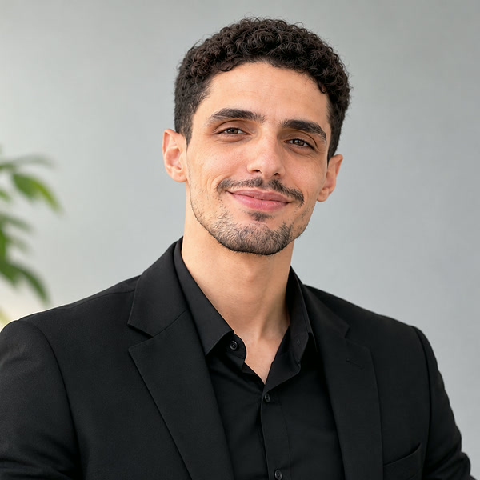

# Marwane Boudouar

**Full-Stack & Mobile Engineer** · 4+ years · Morocco, working remotely (overlaps European hours)

I build mobile apps, web platforms and the pipelines that ship them. For an employee-benefits platform live in Morocco, I build the Flutter app, the Next.js API, the AI HR assistant and the CI/CD behind them.

 

## What I've shipped

| Project | Stack | Highlights |
|---|---|---|
| **Employee benefits app** (iOS + Android) | Flutter, Dart, Firebase, Shorebird, Kotlin, Swift | Two branded apps from one codebase · French, English and Arabic with right-to-left layouts · over-the-air fixes · device attestation · ~1,500 automated tests · 5.0 rating on both stores |
| **Multi-tenant platform API & back office** | Next.js, TypeScript, Prisma, PostgreSQL | 390 API routes · 75 data models · default-deny route policy checked in CI · deterministic housing-assignment engine · transactional outbox for push notifications |
| **AI HR assistant (RAG)** | Python, FastAPI, BGE-M3, FAISS, Claude / Gemini | Answers only from each company's own documents · grounding guard against made-up answers · 68-case hallucination eval required before every merge · French and Moroccan Darija |
| **CI/CD & infrastructure** | Jenkins, GitHub Actions, Docker, nginx, Grafana | 12-stage pipeline with secret, code, dependency, image and attack scans · human approval gate · database backup before every migration · automatic rollback |

The code above is private client work.

## Open source

- **[mockup-studio](https://github.com/Marwanenoudouar10/mockup-studio)**: a Claude Code skill that produces App Store and Google Play screenshot sets, feature graphics, social images and brand boards, with a local Figma-like editor.
- **[motion-explainer](https://github.com/Marwanenoudouar10/motion-explainer)**: a Claude Code skill for narrated motion-graphics explainer videos, rendered with Remotion.
- **[one-cell-to-birth](https://github.com/Marwanenoudouar10/one-cell-to-birth)**: a 16-chapter vertical explainer film made with motion-explainer.
- **[lifeOS](https://github.com/Marwanenoudouar10/lifeOS)**: a life and task manager. React, Express, Prisma and PostgreSQL, about 70 API endpoints.
- **[arena-shooter](https://github.com/Marwanenoudouar10/arena-shooter)**: a Godot 4 arena shooter and aim trainer.

## Stack

  
   
  

## GitHub

  
  

## Work with me

Open to freelance projects: mobile apps, web platforms, AI features you can trust, and CI/CD that deploys without surprises. Email me with a short description of what you need to ship.
