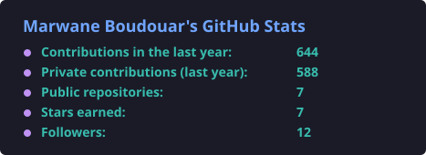
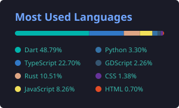

# Marwane Boudouar

**Full-Stack & Mobile Engineer** · 4+ years · Morocco

I build complete products end to end: mobile apps, web platforms, AI features and the infrastructure that runs them, from the first screen to production.

## What I can do

### Mobile development
- Cross-platform iOS and Android apps in Flutter, with clean architecture (MVVM, use cases, dependency injection)
- Several branded apps from one codebase, and multilingual interfaces including Arabic right-to-left
- Native features in Kotlin and Swift: push notifications, maps, QR scanning, device security checks
- Over-the-air updates and releases on the App Store and Google Play

### Web and backend
- Web apps and admin back offices with Next.js, React and TypeScript
- APIs in Node.js and Python (FastAPI) on PostgreSQL with Prisma
- Multi-tenant platforms, role-based access, secure authentication, booking and scheduling logic
- Automated testing at every level: unit, end-to-end, mutation and performance tests

### AI integration
- Assistants that answer from an organisation's own documents (RAG) with hybrid search
- Guardrails against made-up answers, and evaluation suites that measure answer quality
- Claude and Gemini integration, in French, English and Moroccan Darija

### DevOps and security
- CI/CD pipelines with Jenkins and GitHub Actions, Docker and nginx
- Security scans built into every pipeline: secrets, code, dependencies, images and live attack tests
- Safe deployments: approval gates, database backups before migrations, health checks and automatic rollback
- Monitoring and alerting with Grafana

## Stack

  
   
  

## GitHub

  
  

